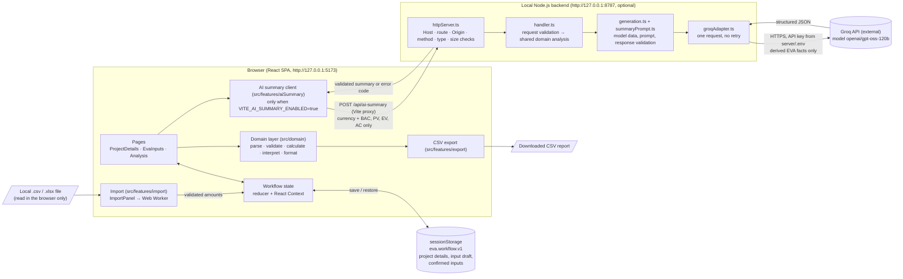

# EVA — Architecture

This document describes the application as it is implemented. Requirements are in
`PROJECT_REQUIREMENTS.md`, formulas in `EVA_FORMULAS.md`, and the reasons behind each choice in
`DECISIONS.md`. Where this document summarizes them, those documents take precedence.

## 1. System overview

EVA is a single-page React application that runs entirely in the browser. It collects project
details and four monetary inputs (BAC, PV, EV, AC), validates them, and produces an Earned Value
Analysis report with interpretations, charts, and a CSV export. All calculations are
deterministic and run in the browser.

One optional feature, the AI-generated summary (FR-21 to FR-24), uses a small Node.js backend that
runs on the user's own computer next to the Vite development server. Only that backend talks to
the external Groq API. Nothing is hosted.

There is **no database, no user accounts, and no authentication**. The only persistence is the
browser's `sessionStorage` for the current tab. Imported files, calculated results, and AI summaries
are never stored.



| Part             | Runs where                        | Talks to                                                     |
| ---------------- | --------------------------------- | ------------------------------------------------------------ |
| React frontend   | Browser                           | `sessionStorage`; the local backend through `/api` (AI only) |
| `sessionStorage` | Browser, current tab              | Frontend only                                                |
| Node.js backend  | User's computer, `127.0.0.1:8787` | Groq API                                                     |
| Groq API         | External service                  | Backend only                                                 |

## 2. Frontend

Vite 8, React 19, and strict TypeScript. Styling is plain CSS with design tokens
(`src/styles/tokens.css`) and CSS Modules; there is no UI framework.

| Folder                    | Responsibility                                                                                                                                      |
| ------------------------- | --------------------------------------------------------------------------------------------------------------------------------------------------- |
| `src/app/`                | `App` (providers, focus on step change), `AppShell`, `ErrorBoundary`, workflow state                                                                |
| `src/pages/`              | The three workflow steps: `ProjectDetailsPage`, `EvaInputsPage`, `AnalysisPage`                                                                     |
| `src/components/`         | Reusable UI: `Button`, `ConfirmDialog`, form `Field`/controls, `Stepper`, `StepActions`, report `MetricList`/`InputSnapshot`/`SignedNumber`, charts |
| `src/domain/`             | Pure EVA logic, no React (section 3)                                                                                                                |
| `src/features/import/`    | File import (section 5)                                                                                                                             |
| `src/features/export/`    | CSV report (section 5)                                                                                                                              |
| `src/features/aiSummary/` | Optional AI summary client, state, and panel (section 7)                                                                                            |

Component relationships:

```text
main.tsx: StrictMode → ErrorBoundary → App
App
└─ WorkflowProvider                 state + sessionStorage mirror
   ├─ skip link
   └─ AiSummaryProvider             in-memory AI state, keyed by the confirmed-inputs fingerprint
      └─ AppShell (header, Stepper, main, footer); focus moves to main on a step change
         ├─ ProjectDetailsPage      Field, controls, StepActions
         ├─ EvaInputsPage           Field, controls, ImportPanel, StepActions
         └─ AnalysisPage            StepHeader, InputSnapshot, MetricList, AnalysisCharts,
                                    budget section, AiSummaryPanel, StepActions, ConfirmDialog
```

## 3. Domain and calculation layer (`src/domain/`)

Framework-free TypeScript functions, shared unchanged by the browser and the backend.

- `parseMonetaryInput.ts`, `validateEvaInputs.ts`: strict parsing of typed or imported amounts and
  every validation rule, including currency-specific decimal places and the no-silent-rounding
  precision rule (`DECISIONS.md` §3).
- `calculateEvaMetrics.ts`: every metric in `EVA_FORMULAS.md`. Undefined results are
  `{ status: 'undefined', reason }`, never `NaN` or `Infinity`.
- `budgetComparison.ts`: BAC − AC and its percentage of BAC (FR-19).
- `analysis.ts`: `createAnalysis(currency, inputs)` returns the one result object read by the
  report, the charts, the CSV export, and the backend.
- `interpretations.ts`, `explainUndefinedMetric.ts`, `metricDefinitions.ts`: deterministic text.
- `formatting.ts`, `currency.ts`: `en-US` display formatting with ISO 4217 minor units; `N/A` for
  undefined values.
- `inputFingerprint.ts`: a stable key for one set of confirmed inputs (used by the AI summary).

Calculated values are never stored and never rounded except for display.

## 4. Workflow state and session storage

`src/app/workflow/` holds a typed reducer exposed through React Context:

```text
WorkflowState = { step, project, inputDraft, confirmed }
actions: GO_TO_STEP · NEXT_STEP · PREVIOUS_STEP · UPDATE_PROJECT · UPDATE_INPUT_DRAFT ·
         CONFIRM_INPUTS · RESET
```

- `inputDraft` holds the raw text exactly as typed or imported. `confirmed` holds the validated
  numbers from the last "Calculate analysis"; the report, charts, and export read only `confirmed`.
- The reducer guards navigation: EVA inputs need a valid project name, and the analysis needs
  confirmed inputs.
- `WorkflowProvider` writes the state to `sessionStorage` under `eva.workflow.v1` after every
  change. On load, `workflowStorage.ts` validates the stored data (including the monetary rules
  for confirmed inputs) and falls back to the empty state if anything is malformed.
- `RESET` ("Start a new analysis", FR-11, after a confirmation dialog) returns the initial state;
  the next save overwrites the stored copy with that empty state.
- `sessionStorage` is per tab and is cleared when the tab closes. It holds the project details in
  plain text on the user's own device; nothing is sent anywhere.

## 5. File import and CSV export

**Import** (FR-13 to FR-18), on the EVA inputs step:

```text
ImportPanel ─ choose file
  → checkImportFile        extension, reported type, 1 to 1,048,576 bytes (before reading)
  → runImport              starts import.worker.ts; terminated after 10 seconds
      → processImportFile  verifies the content, then CSV: parseCsv · XLSX: zipArchive +
                           workbookStructure (archive safeguards) + readXlsxSheet
                           (read-excel-file)
      → interpretSheet     header mapping, file-level errors, per-row validateEvaAmounts
  → preview                rows, statuses, error summary; exactly one valid row selectable
  → "Use these values"     toPlainDecimal → UPDATE_INPUT_DRAFT (currency + four amounts)
```

The file never leaves the browser and is never stored. Confirming an import changes only the input
draft; the user still chooses "Calculate analysis".

**Export** (FR-09, FR-25, FR-26): `reportCsv.ts` builds rows from the shared analysis (metadata,
inputs, metrics with raw and display values, definitions, interpretations, the budget comparison,
assumptions, and the current AI summary if one exists). `csv.ts` neutralizes spreadsheet formulas,
then escapes fields (RFC 4180, CRLF, UTF-8 with BOM). `downloadCsv.ts` starts the download.

## 6. Optional local Node.js backend (`server/`)

Started with `pnpm dev:ai` (`scripts/dev-ai.mjs` runs Vite and the backend together). It uses only
Node's built-in HTTP server and imports `src/domain/` directly, so it applies exactly the same
validation and formulas as the report.

- `main.ts`: reads configuration, listens on `127.0.0.1:8787` only, stops cleanly.
- `config.ts`: reads `GROQ_API_KEY` and `GROQ_MODEL` from the Git-ignored `server/.env`. The only
  accepted model is `openai/gpt-oss-120b`; any other value, or a secret-looking `VITE_` variable,
  stops the backend. Without both values every valid request receives `503 ai_not_configured`.
- `secret.ts`: wraps the key so it never prints.
- `httpServer.ts`: checks in order Host (loopback names only), route (`/api/ai-summary`), Origin
  (the Vite origin only), method (POST), content type (JSON), and size (2,048 bytes). It sends no
  CORS headers and logs only a request id, time, status, error code, and duration.
- `handler.ts`: decodes and validates the request (`requestValidation.ts`), recomputes the
  analysis from the four inputs, applies a 25-second deadline, and returns the summary with a
  server-computed input fingerprint.

## 7. Groq integration and the AI request lifecycle

```text
Browser                               Local backend                         Groq
───────                               ─────────────                         ────
"Generate AI summary" (explicit)
POST {schemaVersion, currency,  ──▶   validate request
      inputs: {bac,pv,ev,ac}}         createAnalysis → buildModelData
  (30 s client timeout, no retry)     (derived facts and display strings;
                                       no project details)
                                      summaryPrompt: system rules +
                                       <eva_data> JSON                ──▶  chat completion,
                                      groqAdapter: one request,             strict JSON schema
                                       no retry, no redirects          ◀──
                                      validateSummaryContent: schema,
                                       evidence keys, numbers must match
                                       display values, no markup/links
                    ◀──               200 {inputFingerprint, generatedAt,
                                           modelLabel, content}
                                      or a fixed error code
show only if the request is still
current and the fingerprint matches
```

- **Data sent:** the browser sends only the currency and the four confirmed inputs. The backend
  sends Groq only facts derived from them. The project name, description, manager, and reporting
  date never leave the browser.
- **Lifecycle (frontend, `AiSummaryProvider`):** idle → loading → success or error. One request at
  a time; Cancel aborts it. Confirming different inputs, or a reset, aborts any pending request and
  discards the summary; a late response is ignored because its request is no longer current. The
  summary lives in memory only, so a reload discards it.
- **Untrusted output:** the model's text is validated on the server and rendered as plain text
  only. It never changes inputs, metrics, or the deterministic report.
- **Errors:** the frontend shows fixed messages per error code (`ai_unavailable`, `ai_timeout`,
  `rate_limited`, `ai_not_configured`, …), never provider text. The rest of the report and the
  export keep working.
- **Build flag:** `VITE_AI_SUMMARY_ENABLED=true` only shows or hides the section; it is not a
  security control. The default build has no AI section and makes no `/api` requests.

## 8. Security boundaries

- The Groq key exists only in `server/.env` (permissions `600`, Git-ignored) and in the backend
  process. `pnpm check:build` scans built frontend output for the Groq URL, key name, an
  `Authorization` header, and key-shaped strings.
- Binding to `127.0.0.1` and checking Host and Origin protect against other websites and DNS
  rebinding. They are **not** authentication: any program on the same computer can call the
  endpoint, and there is no rate limiting. A public deployment would need authentication, rate
  limits, HTTPS, a secret manager, and security headers; none of these exist because nothing is
  deployed.
